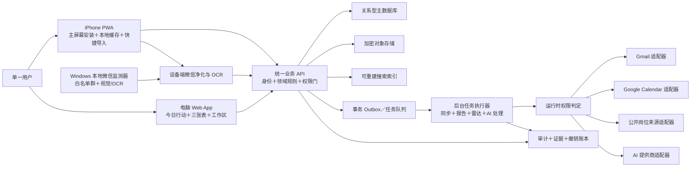

# 港大 MFin 个人系统：Phase 0 实施规划

## 2026-11-11 当前维护授权（优先于下文历史状态）

- D25：用户永久移除全部微信功能，包括监测、OCR、配对、分享与专用手动导入。历史岗位、证据和审计只读保留；旧迁移不可改写。不可重新启用微信能力。
- D26：用户授权把 reports.generate、calendar.update_product_event、calendar.write_confirmed_plan 恢复为持续授权；隐私锁、依赖和计划确认仍有效，不自动扩大其他权限。
- 本次明确批准跨里程碑修复、必要迁移及现有 Production 发布。每日自动搜岗继续暂停，AI 未完成部分不得冒称恢复正常。
- 旧 Supabase 项目优先免费保全；恢复因两个活跃免费项目上限失败，不得自行暂停正式/测试项目或付费。


> 文档状态：M0-M7 单目标群快速上线、Production、Calendar、日报与岗位发现 V0 控制面已完成；D14-D16 已确认，Goldman Sachs 首个真实公开来源已在隔离 Test 实施但未启用
> 规划范围：第一阶段“核心闭环”
> 明确排除：第二阶段浏览器自动化、凭据保险库、验证码读取、高级面试与 Offer 比较；Windows 微信白名单监测已由用户明确提前纳入 M7
> 产品约束来源：项目根目录 `AGENTS.md`

## 1. 本轮结论

建议采用以下总体方案：

- iPhone 端使用可安装 PWA，承担今日简报、Web Push、微信一键导入、快速确认、Passkey/设备再验证和短暂离线。
- 电脑端使用同一 Web App，承担三张长期表、材料处理、课程工作区、搜索、复盘和设置。
- 两端只通过同一个云端业务服务读写产品数据，不直接彼此同步。
- 后端采用“模块化单体＋独立后台任务执行器”，第一阶段不拆微服务。
- 核心业务数据使用关系型数据库，文件使用独立对象存储，搜索索引可以从业务数据重建。
- 使用统一领域模型和 OpenAPI 契约约束浏览器客户端与服务端，避免移动和电脑视图的字段与状态含义漂移。
- Gmail、Google Calendar、公开岗位来源和 AI 提供商均通过适配器接入，不侵入核心领域逻辑。
- 权限判定是所有自动化的服务器端前置门，不只是界面里的开关。
- 审计、来源证据、字段锁定、撤销和同步冲突从第一阶段底座开始建设，不能后补。

这套结构优先满足单用户、可追溯、低维护和双端一致性，同时为后续只读浏览器自动化保留安全边界。Windows 微信白名单监测已单独获批纳入 M7，但仍按本地实验能力设置独立安全门。

## 2. 当前项目环境检查

### 2.1 已确认状态

- 项目已完成 M0：Git、README、ADR、环境/安全/测试文档、无依赖治理脚本和 CI 基线已建立；仍没有产品业务代码、数据库、云资源或外部账号连接。
- D01 已于 2026-08-07 确认并执行；`docs/PRODUCT_SPEC.md` 与迁移前完整 `AGENTS.md` 的 SHA-256 一致。
- 用户已确认第一阶段采用 iPhone PWA＋电脑 Web App，不购买 Apple Developer Program，也不依赖 Xcode/iOS 原生编译环境。
- 当前可发现 Git；Codex 工作区提供 Node.js 24 与 pnpm 11 运行时。正式本机 Node.js、数据库或容器工具链仍未安装或未确认。
- M1 仅连接隔离的 Google Cloud 基础身份项目、Supabase 测试项目与 Vercel 测试部署；没有连接 Gmail、Google Calendar、微信、Apple 或任何 AI 供应商账户。

### 2.2 对实施的影响

- Web/PWA、后端、数据模型和测试替身可以在当前 Windows 环境建设。
- PWA 主屏幕安装、响应式 UI、Passkey/Face ID 与离线行为已在 iPhone 16 Pro Max（iOS 26.1）验收；Web Push 和微信快捷导入保留给其对应后续里程碑。
- 第一阶段编码前应初始化 Git，并建立开发、测试、预发布和生产环境的边界。
- 产品宪法已迁移到 `docs/PRODUCT_SPEC.md`，根目录 `AGENTS.md` 已精简为执行索引；后续 Agent 必须按索引完整读取产品规格。

### 2.3 文档来源处理

- `docs/PRODUCT_SPEC.md` 是完整产品真相源。
- 根目录 `AGENTS.md` 是精简执行索引，不替代产品规格。
- `docs/DECISIONS.md` 记录用户已经确认的决策；未记录为已确认的事项不得自行决定。
- 产品决策继续写入产品规格；技术决策写入本实施计划或后续 ADR，不把易过时的技术细节写回产品宪法。

## 3. 架构原则

### 3.1 固定原则

1. **服务器是产品业务数据真相源**：三张长期表、行动、材料、报告、权限和时间线以服务器记录为准。
2. **Google Calendar 是外部日程真相源**：它负责每日事件、时间和提醒，但不承担岗位或课程发展历史。
3. **追加历史，不覆盖历史**：状态表保存当前视图，时间线和审计保存演进事实。
4. **用户输入优先**：用户手动修改字段自动加锁；AI 只能提出修改建议。
5. **权限实时生效**：每次任务开始及每个安全写入点都重新计算有效权限。
6. **外部系统可替换**：业务层不直接依赖 Gmail、Calendar 或具体 AI SDK。
7. **失败必须可见**：同步失败、来源失效、权限过期和部分完成都进入状态中心。
8. **单用户但不省略隔离**：不建设组织权限，却仍以 `owner_id` 隔离数据，保持明确安全边界。

### 3.2 明确不采用

- 第一阶段不拆分微服务。
- 不使用 Google Sheets 作为三张长期表。
- 不使用 Google Tasks。
- 不让 iPhone 或 Web 直接持有 Gmail/Calendar 长期令牌。
- 不用聊天记录充当唯一业务数据库。
- 不把向量数据库作为核心真相源。
- 不在第一阶段实现招聘平台自动登录或任何申请提交动作。

## 4. 整体逻辑架构



### 4.1 iPhone PWA

职责：

- 今日行动、晨报、晚间收尾和周报阅读。
- Push 通知和高价值事件提醒。
- 通过系统分享/快捷指令与产品导入页接收文字、截图、文件和链接。
- 浏览器端或受控服务端 OCR、裁剪和净化预览；上传前尽量完成本地净化。
- 快速确认、追踪、申请意向、完成、重排和撤销。
- Passkey/WebAuthn 触发 Face ID 或设备验证，作为敏感操作再验证门禁。
- Service Worker＋本地存储支持短暂离线读取与待同步操作队列。

不承担：

- 后台全网岗位搜索。
- 长期保存第三方 OAuth 凭据。
- 复杂材料生成流水线。
- 服务器级定时报告调度。

### 4.2 Web App

职责：

- 今日行动完整视图。
- 实习、秋招和学业三张正式表格。
- 详情侧栏、追加时间线、筛选、排序和保存视图。
- 材料版本、申请快照、课程资料和富文本笔记。
- 统一收件箱、搜索、复盘、权限中心、状态中心和审计中心。
- 较复杂的冲突解决、证据查看和批量确认。

第一阶段不要求 Web 离线编辑；断网时应明确只读或提示操作未提交，不得伪装成功。

### 4.3 业务 API

采用一个模块化单体，对外提供统一、版本化的 JSON API。建议用 OpenAPI 作为浏览器客户端与服务端的契约真相源。

内部模块建议：

- Identity：Google 登录、会话和再验证状态。
- Profile：onboarding 和岗位画像。
- Permissions：总开关、分类、细项、临时授权和隐私锁。
- Inbox：统一收件箱与待确认队列。
- Opportunities：候选池、实习表、秋招表和申请阶段。
- Academics：课程、Module、任务、资料和笔记。
- Actions：行动、优先级、依赖、排期和完成。
- Calendar：事件镜像、关联、冲突和同步状态。
- Communications：Gmail 摘要、微信净化结果和证据。
- Artifacts：文件、版本、派生材料和申请快照。
- Reports：晨报、晚间收尾和周报。
- Search：统一检索与权限过滤。
- Automations：任务编排、状态、安全停止和重试。
- Audit：来源、操作记录、字段变更和撤销。

### 4.4 后台任务执行器

后台任务与交互 API 分离运行，但共享同一代码库、领域规则和数据库。

职责：

- Gmail 增量同步与邮件分类。
- Calendar 增量同步、写入和冲突检测。
- 公开岗位来源采集、标准化、去重、核验和评分。
- 报告定时生成。
- AI 提取、分类、总结和材料派生。
- 文件解析、OCR 后处理和搜索索引更新。
- 过期临时权限关闭、队列取消和状态通知。
- 每日加密备份与恢复校验任务。

每个任务必须具备：

- 幂等键，避免重复邮件、事件、岗位和报告。
- 权限快照与执行前二次校验。
- 可取消状态和明确安全停止点。
- 有限重试、指数退避和失败队列。
- 来源证据、输入版本、结果和错误代码。
- 不把正文、令牌、验证码或完整材料写入普通日志。

## 5. 推荐技术方向与待定边界

以下区分已确认技术底座与后续里程碑待定项：

| 层 | 推荐方向 | 原因 | 当前状态 |
|---|---|---|---|
| iPhone/电脑 | TypeScript＋Next.js 响应式 PWA | 同一代码库覆盖主屏幕安装、表格、移动列表、Web Push 与离线缓存 | 已确认 |
| API/Worker | TypeScript 模块化单体 | 与 Web 共用类型工具，单用户系统维护成本低 | 语言已确认；Worker 运行方式待相关里程碑确认 |
| 契约 | OpenAPI＋类型生成 | 浏览器客户端与服务端保持一致，避免直接共享领域实现 | 建议确认 |
| 主数据库 | Supabase 托管 PostgreSQL（新加坡） | 关系、时间线、审计、搜索和事务适配度高 | 隔离 Test 项目已用于 M1-M2 |
| 身份/文件 | Supabase Auth 与 Storage | 降低单用户系统维护成本，继续通过领域与适配器边界隔离 | Auth 已用于 M1；Storage 尚未启用业务数据 |
| 任务 | 持久化队列＋定时调度 | 支持取消、重试、幂等和可观察状态 | 待确认具体产品 |
| 搜索 | PostgreSQL 检索起步，按需增加向量索引 | 降低第一阶段复杂度，索引可重建 | 中英混合检索方案待验证 |
| AI | 供应商适配层＋结构化输出 | 可更换模型，便于成本、隐私和质量评测 | 待确认供应商与数据策略 |
| 部署 | Vercel 托管 Web/PWA；后台任务独立评估 | 先建立低成本 Web 交付，避免过早锁定任务运行时 | 隔离 Web 项目已部署；Worker 仍待后续里程碑 |

已确认第一阶段底座为 Next.js Web/PWA、TypeScript 模块化后端、Supabase（新加坡）和 Vercel。开发阶段优先免费套餐；真实数据接入前重新确认可靠性、备份和付费边界。持久化任务队列与 Worker 运行方式在需要自动化调度前单独写入 ADR。

## 6. 双端同步设计

### 6.1 数据权威

- 产品领域对象：云端数据库权威。
- Google Calendar 事件时间与提醒：Calendar 权威，但产品保存稳定映射和最近同步版本。
- Gmail 原邮件：Gmail 权威；产品只保存摘要、必要证据和链接。
- 产品内文件：对象存储权威，数据库保存元数据和版本关系。
- PWA 本地数据：缓存和待同步操作，不是最终真相源。

### 6.2 同步协议

- 所有可编辑记录带稳定 ID、版本号、更新时间和删除/归档状态。
- 客户端使用游标增量拉取，不全量刷新整个账户。
- PWA 离线操作先进入本地 Outbox，联网后按原顺序提交。
- 写入使用乐观并发控制；版本不一致时创建显式冲突，而不是最后写入者静默获胜。
- 用户手动字段锁是字段级元数据，必须随记录同步。
- 高风险操作使用服务器签发的短期确认令牌，防止旧页面重复提交。

### 6.3 冲突规则

| 场景 | 默认处理 |
|---|---|
| 两端修改不同字段 | 自动合并并追加时间线 |
| 两端修改同一未锁字段 | 进入冲突队列，展示双方版本 |
| AI 与用户手动字段冲突 | 用户版本保留，AI 生成带证据建议 |
| Calendar 时间与产品时间同时变化 | 标记冲突，显示来源和更新时间 |
| Calendar 删除关联事件 | 询问取消排期或重新同步 |
| 离线操作对应对象已归档/删除 | 不静默恢复，要求用户确认 |

## 7. 建议项目目录

```text
学业求职System/
├── AGENTS.md
├── README.md
├── docs/
│   ├── PRODUCT_SPEC.md
│   ├── IMPLEMENTATION_PLAN.md
│   ├── DECISIONS.md
│   ├── SECURITY_MODEL.md
│   ├── DATA_MODEL.md
│   ├── TEST_STRATEGY.md
│   ├── RUNBOOKS/
│   └── adr/
├── apps/
│   └── web/                 # 同时提供电脑 Web 与 iPhone PWA
├── services/
│   ├── api/
│   └── worker/
├── packages/
│   ├── contracts/
│   ├── domain/
│   ├── permissions/
│   ├── audit/
│   ├── integrations/
│   ├── config/
│   └── test-fixtures/
├── infra/
│   ├── environments/
│   ├── migrations/
│   └── monitoring/
├── tests/
│   ├── contract/
│   ├── integration/
│   ├── e2e-web/
│   ├── e2e-mobile-pwa/
│   ├── privacy/
│   └── recovery/
└── scripts/
```

说明：

- `packages/contracts` 保存 API 和事件契约，不保存任何密钥。
- `packages/domain` 保存与供应商无关的领域规则。
- `packages/integrations` 只包含接口与适配器边界；真实凭据由运行环境注入。
- 浏览器客户端不得复制服务端领域规则；跨边界数据由 OpenAPI 和契约测试约束。
- `docs/adr` 每个关键技术选择一份记录，包含背景、选项、决定和后果。

## 8. 核心数据对象

### 8.1 身份、连接与权限

| 对象 | 关键职责 |
|---|---|
| UserProfile | 单用户资料、时区、语言、报告时间和 onboarding 状态 |
| JobPreferenceProfile | 实习/秋招各自的主攻、相邻、探索、排除和硬性条件 |
| ExternalConnection | Gmail、Calendar 等连接状态、范围、最近成功和错误，不保存明文令牌 |
| SecretReference | 指向加密令牌存储的引用，与普通业务表分离 |
| CapabilityDefinition | 可授权能力清单、分类、风险、依赖和是否允许临时授权 |
| PermissionGrant | 关闭、仅本次、限时或持续授权及到期时间 |
| PrivacyLock | 全局锁状态、触发者、触发时间和恢复验证状态 |
| AutomationRun | 空闲/运行/暂停/取消/失败、进度、安全点和权限快照 |

### 8.2 来源、收件箱与证据

| 对象 | 关键职责 |
|---|---|
| SourceRecord | Gmail、Calendar、微信、公开来源、用户上传等来源元数据 |
| Evidence | 必要证据片段、哈希、原始链接、发现时间和最近核验时间 |
| InboxItem | 统一收件箱项目、建议分类、置信度和待确认状态 |
| Communication | 邮件摘要、微信净化内容、行动/回复需求及上下文关联 |
| DataSourceCoverage | 来源覆盖范围、最后成功、缺口和不可用原因 |

### 8.3 求职

| 对象 | 关键职责 |
|---|---|
| OpportunityCandidate | AI/来源新发现的候选，不自动进入长期表 |
| Opportunity | 用户选择追踪/申请后建立的正式岗位记录 |
| OpportunityAssessment | 资格、匹配、意愿、紧迫、成本、缺口和解释 |
| Application | 投递日期、主阶段、子阶段、等待方和下一步 |
| ApplicationSnapshot | 当时 JD、材料版本、答案、提交信息和来源快照 |
| InterviewOrTest | 每轮测试/面试类型、时间、结果和相关事件 |
| OpportunityTimelineEntry | 追加式岗位发展历史，不允许覆盖旧事件 |

实习与秋招可共用底层模型，但必须通过不可为空的领域字段、独立默认视图、独立候选池和独立报告区块保持严格分离。

### 8.4 学业

| 对象 | 关键职责 |
|---|---|
| Course | Module、代码、日期范围、固定时段和手动状态 |
| CourseTask | 作业、考试、Presentation、项目和个人分工等 |
| CourseMaterial | 课纲、课件、阅读和其他资料及版本 |
| CourseNote | 内置富文本笔记和外部笔记入口 |
| MasteryMarker | 用户手动掌握度；不由浏览时长自动推断 |
| CourseTimelineEntry | 课程、任务、资料和状态的追加式历史 |

### 8.5 行动、日程与报告

| 对象 | 关键职责 |
|---|---|
| Action | 所属上下文、截止、建议开始、耗时、依赖、状态和完成标准 |
| CalendarEventLink | 产品对象与 Google 事件稳定映射、版本和同步状态 |
| SyncConflict | 双向同步冲突、双方版本、解决方式和解决者 |
| Report | 晨报、晚报、周报的生成时间、数据截止点和内容版本 |
| ReportItem | 报告条目、排序理由、来源、状态和跳转目标 |
| Notification | 推送类型、原因、去重键、发送状态和用户处理结果 |

### 8.6 文件、搜索与治理

| 对象 | 关键职责 |
|---|---|
| Artifact | Master CV、派生材料、成绩单、课程资料等逻辑文件 |
| ArtifactVersion | 每个文件的不可变版本、哈希、来源和存储引用 |
| CustomFieldDefinition/Value | 三张表的用户自定义字段，不破坏核心状态 |
| FieldLock | 用户手动修改的字段锁及解除历史 |
| SearchDocument | 可重建索引文档及原对象权限范围 |
| AuditEvent | 谁、何时、基于何证据、在何权限下执行何操作 |
| UndoOperation | 可逆操作、补偿动作、有效期和执行结果 |
| TrashEntry | 30 天回收站与立即永久删除状态 |

### 8.7 数据一致性要求

- 时间线、审计和文件版本采用不可变追加模型。
- 当前状态是历史的投影视图，必须能从关键事件重建或核验。
- AI 生成内容保存模型/策略版本、输入证据引用和置信度，不保存不必要的完整敏感输入。
- 外部对象保存 provider ID、provider version/etag 和最近同步时间。
- 删除业务数据时同步处理索引、缓存和备份保留策略；凭据删除不进入回收站。

## 9. 权限模型

### 9.1 能力注册表

权限不直接绑定页面，而绑定具体能力。第一阶段至少定义：

- `ai.analysis`
- `ai.recommendation`
- `ai.material_draft`
- `gmail.connection`
- `gmail.sync`
- `gmail.analysis`
- `gmail.personal_action_extract`
- `gmail.attachment_import`
- `calendar.connection`
- `calendar.read`
- `calendar.write_fact`
- `calendar.write_confirmed_plan`
- `calendar.update_product_event`
- `job_radar.discovery`
- `job_radar.scoring`
- `job_status.auto_update`
- `wechat.import`
- `wechat.local_sanitize`
- `academic.extract`
- `files.upload`
- `reports.generate`
- `notifications.smart_push`

邮件发送、微信发送、联系他人、岗位投递、申请提交、修改招聘平台资料等能力不进入注册表，任何配置都不能创建这些权限。

### 9.2 有效权限计算

一次动作只有同时满足下列条件才允许执行：

1. 隐私锁关闭。
2. 相关外部连接为“已连接”且健康。
3. AI 动作需要 AI 总开关开启；基础同步不受 AI 总开关影响。
4. 分类权限开启。
5. 细项权限为仅本次、未过期限时或持续开启。
6. 所有依赖权限均有效。
7. 当前动作不属于产品永久禁止能力。
8. 若需再验证，服务器持有未过期的再验证证明。

权限结果必须返回明确拒绝原因，例如隐私锁、连接暂停、授权过期、依赖关闭、需要确认或永久禁止。

### 9.3 临时授权

- “仅本次”绑定明确的 operation ID，首次成功、失败终止或用户取消后即失效。
- “24 小时”在服务器使用绝对到期时间；客户端只展示本地时区。
- 到期任务在下一安全点停止，待执行任务立即取消。
- 恢复权限时只生成“待补处理范围”，用户确认后创建新任务，旧任务不得复活。

### 9.4 隐私锁

- 隐私锁是服务器权威状态，并向两端实时传播。
- 启用后：外部连接访问、后台采集、AI、同步和上传停止；三张表只读。
- 解锁需要 Passkey/WebAuthn 产生的设备验证或 Web 重新登录产生的服务器再验证证明。
- 解锁不自动补跑历史任务。

### 9.5 Passkey 与设备验证边界

Passkey/WebAuthn 只能证明“当前设备完成了系统级验证”，不能替代服务器会话和 Google OAuth。服务器应接收短期、绑定设备与操作的再验证结果，而不是 Face ID/Touch ID 生物信息。

## 10. 审计、证据与撤销

### 10.1 审计事件至少记录

- event ID、发生时间和关联 trace ID。
- 操作者：用户、AI、同步器、定时任务或系统恢复。
- 动作、对象类型、对象 ID 和影响字段。
- 动作前后结构化差异或不可逆操作摘要。
- 使用的证据 ID、规则/模型版本和置信度。
- 执行时的有效权限结果和临时授权 ID。
- 成功、失败、取消、部分完成及错误代码。
- 是否可撤销、撤销截止时间和补偿操作引用。

### 10.2 不得进入普通审计日志

- OAuth refresh token、账号密码和验证码。
- 完整邮件正文、完整简历或完整课程文件。
- 不必要的微信群成员信息。
- 可直接恢复敏感内容的原始请求体。

### 10.3 撤销语义

- 自动岗位状态更新：恢复旧状态，同时追加“撤销”时间线，不删除原历史。
- 自动创建 Calendar 事件：删除或取消产品创建事件前再次检查关联与权限。
- 自动导入附件：进入回收站或按用户选择立即永久删除。
- 自动分类：恢复原分类并记录用户纠正，后续模型不得静默覆盖锁定结果。
- 外部操作撤销失败时必须显示原因，不得把本地恢复伪装成外部已恢复。

## 11. Google Calendar 集成方案

### 11.1 结构

- 由用户 Google 账户拥有一本独立产品日历，名称待用户确认。
- 首次连接读取全部已有日历事件用于冲突判断，但产品写入只进入产品日历，除非用户明确选择其他目标。
- 产品创建事件保存稳定 `CalendarEventLink`，使用 provider event ID 和版本字段去重。
- 时间事项与全天事项分别映射；未指定日期的候选任务不写入。

### 11.2 标签

Google Calendar 当前官方 API 支持在单本日历定义最多 200 个带名称和十六进制背景色的自定义标签，并通过 `eventLabelId` 分配给事件；请求需携带 `eventLabelVersion=1`，修改标签要求日历 owner 权限。第一阶段可据此建立学业、实习、秋招和个人四个标签。

参考：[Google Calendar Labels 官方文档](https://developers.google.com/workspace/calendar/api/guides/labels)

### 11.3 双向同步

- 使用增量同步游标/版本，避免全量轮询。
- 产品事件标题由产品生成并保留类别、完成或取消状态。
- 用户从 Calendar 改时间：产品接收并更新排期，追加同步历史。
- 用户删除关联事件：建立冲突，不自动重建。
- 用户原有事件默认只读；任何修改或删除都必须逐项确认。
- Calendar 权限暂停时只记录“待同步”，不重试写入。

## 12. Gmail、微信与岗位来源边界

### 12.1 Gmail

- 登录身份与 Gmail/Calendar 数据授权分开记录，即使使用同一个 Google 账户。
- 后端持有最小范围 OAuth 授权，客户端不保存长期令牌。
- 增量读取邮件元数据和需要处理的内容；只保留产品宪法允许的摘要、行动、证据和 Gmail 链接。
- 原始收件地址和转发头用于恢复 163/港大邮件归属。
- Gmail 适配器不实现发送、归档、删除、标签或已读状态变更。
- 草稿第一阶段先在产品内生成；是否创建 Gmail Draft 对象需单独确认。

### 12.2 微信

- M7 主路径是在 Windows 开机、用户会话可用且微信已登录期间，自动巡视用户明确配置的白名单招聘群；只使用桌面端可见界面进行本地视觉/OCR，不使用不存在的个人微信官方读取 API。
- 本地先完成新消息判断、OCR、JD 判断、裁剪和隐私净化；服务器只接收 JD 最小投影、必要证据、来源时间和监测健康状态，不接收完整群聊。
- iPhone 系统分享/快捷指令和产品导入页保留为公众号、小程序内部内容、非白名单来源和漏网项的兜底。
- 不索取微信密码，不导出微信数据库，不注入或修改客户端，不绕过安全机制，不读取非白名单群，不执行发送、回复、联系人操作或申请提交。
- UI 身份无法确认、微信版本/布局变化、账号异常、锁屏、微信退出或隐私误采风险出现时安全停止，并在状态中心显示覆盖缺口。

### 12.3 公开岗位来源

- 每个来源一个只读适配器，声明覆盖范围、更新频率和使用限制。
- 第一阶段只处理公开可访问或用户明确提供的数据。
- 去重同时保留多个来源证据，不把相似公司名直接合并。
- 来源失效后报告必须显示覆盖缺口，不使用旧数据冒充当日发现。

## 13. 第一阶段里程碑

每个里程碑都应形成可演示、可回归、可独立验收的增量。未经用户确认当前里程碑，不进入下一项。

### M0：决策门与项目治理（已完成，2026-08-09）

交付物：

- 初始化 Git、README、文档目录和 ADR 模板。
- 规范化 `AGENTS.md`/`PRODUCT_SPEC.md` 职责，但不改变产品规则。
- 确认本计划第 16 节的阻塞决策。
- 确定开发、测试、预发布和生产环境边界。
- 建立密钥管理、提交规范、CI 基线和分支策略。

依赖：D02-D04、D17、D19 已确认；M0 本身不要求云账号或 iPhone 验收。

验收：

- 新任务能完整读取产品规格而不被大小截断。
- 仓库不包含真实密钥或账号数据。
- CI 能执行空项目的格式、静态检查和测试入口。
- 第二阶段目录或能力没有被实现。

### M1：PWA/Web 外壳、身份与设计系统（已完成，2026-08-10）

交付物：

- 同一响应式 Web/PWA 工程的电脑与 iPhone 外壳。
- Google 登录、服务器会话和登出。
- 今日行动、实习、秋招、学业、设置的空状态导航。
- 暖白/墨黑蓝/冷灰/低饱和深绿的设计 token，浅色与深色主题。
- PWA 安装、离线壳、Web Push 能力检测和 Passkey/设备再验证框架。

依赖：M0；Google OAuth 测试项目；真实 iPhone Safari 验收条件。

验收：

- 同一测试用户可在两端登录并看到一致账号。
- 未登录不能访问业务数据。
- 两端主导航和视觉基线一致，iPhone 支持单手核心操作。
- Passkey/设备验证失败不会泄露缓存的敏感详情；不支持的能力会明确降级而不伪装成功。

验收结论：自动化测试与生产构建通过；隔离 Vercel 部署的 HTTPS、Google OAuth、SSR 会话、退出和路由保护通过；iPhone 16 Pro Max（iOS 26.1）的主屏幕安装、导航布局、设置页、离线启动和 Passkey/Face ID 注册登录通过。

### M2：核心数据、权限、审计与任务底座（已完成，2026-08-10）

交付物：

- 核心对象最小数据库迁移。
- 能力注册表、权限计算、临时授权和隐私锁。
- 审计事件、证据引用、字段锁和撤销框架。
- 后台任务状态、取消、安全点、重试和失败队列。
- 状态中心基础页。

依赖：M1；数据库、队列和密钥管理选择。

验收：

- AI 总开关关闭不影响基础连接状态查看，但阻止 AI 行为。
- 隐私锁立即阻止外部访问和新任务，三张表进入只读。
- 一次性/限时权限按规则失效并取消未执行任务。
- 永久禁止能力无法通过配置创建。
- 日志扫描不出现令牌、验证码或原始敏感内容。

验收结论：隔离 Supabase PostgreSQL 17 已应用核心与安全加固迁移；公开表全部启用 RLS 并使用显式最小 Data API 授权；真实事务验证 AI 总开关、隐私锁、重新验证、一次性/限时权限、任务取消、安全点、重试、dead-letter、敏感载荷拒绝和永久禁止能力；状态中心、全量 CI、Vercel 生产构建与未登录路由保护通过。未连接后续外部数据源，也未启动定时 Worker。

### M3：三张长期表、行动与双端同步（已完成，2026-08-10）

交付物：

- 候选池、实习表、秋招表和学业表。
- 详情侧栏/详情页、追加时间线、归档、筛选、排序和保存视图。
- Action 模型、下一步、等待方、完成/取消和依赖。
- 用户自定义字段与字段锁。
- PWA 本地缓存、离线 Outbox 和显式冲突处理。

依赖：M2。

验收：

- 候选岗位只有“追踪/申请”后进入正式表。
- 实习与秋招无法静默串线。
- 状态变化追加历史，不覆盖旧记录。
- 用户字段锁阻止 AI 自动覆盖。
- 两端并发编辑同字段产生可处理冲突，不静默丢失数据。

验收结论：隔离 Supabase 已应用 M3 核心工作区及加固迁移；候选池只经显式追踪进入实习/秋招表，轨道不可静默修改；状态变化追加时间线；Action 支持等待、完成、取消与无环依赖；自定义字段写入同步建立字段锁。PWA 使用 IndexedDB 保存最小快照与 Outbox，服务端以对象版本、基线字段和 mutation ID 实现幂等、不同字段自动合并、同字段显式冲突及人工解决。全量 CI、生产构建、桌面/移动响应式检查、真实 PostgreSQL 回滚事务和 Advisor 复核通过。未连接任何 M4 外部服务。

上线后增强（2026-08-30，D24；2026-08-31 更新）：实习页增加完整 JD 粘贴入口。`jd_rules_v2` 在浏览器预览并由服务端重新解析公司、岗位、部门、地点、JD 发布时间、截止日期、职责、要求、申请方式和 HTTPS 来源；远程或混合办公信息直接并入地点。规则覆盖 SEEK 类整页复制、网页噪声、相对发布时间与常见英文标题。用户点击保存等同明确追踪，原子写入候选证据、实习长期表、时间线和审计。相同原文按 SHA-256 幂等。D07/D08 未确认，因此不连接外部 AI；每日自动搜岗仍等待用户后续命令。

### M4：Google Calendar 闭环

交付物：

- Calendar 独立授权、连接状态和最小权限说明。
- 产品日历、四类标签、时间/全天事件和返回产品链接。
- 产品事件双向时间同步、完成/取消标题和历史保留。
- 用户原有事件只读保护、删除冲突和待同步状态。

依赖：M2、M3；Google Cloud 测试项目。

验收：

- 时间事项和全天事项映射正确且不重复。
- 四类事件标签和标题正确。
- 完成后事件保留并显示完成状态。
- Calendar 写权限关闭时只产生“待同步”。
- 删除关联事件时要求选择取消排期或重新同步。
- 修改用户原有事件必须确认。

实现状态（2026-08-10）：代码、隔离数据库迁移、回滚事务、Adapter/领域测试、生产构建、Advisor 与桌面/移动视觉检查已通过。尚待用户在专用 Google 测试账号完成最小 OAuth 授权和真实 Calendar 联调；完成前不标记 M4 验收完成。

### M5：今日行动与报告

交付物：

- 今日固定日程、必须事项、三个 AI 重点、双线岗位区块、风险和待确认。
- 08:00 晨报、22:30 晚间收尾、周日 20:00 周报的可编辑计划。
- 报告数据截止点、来源健康和生成状态。
- 智能通知去重与白名单规则。

依赖：M3、M4；报告/通知权限底座。

验收：

- 用户可在两分钟内读完默认首页并定位前三项行动。
- 每条求职线最多 5 个重点岗位，不以低质量内容凑数。
- 白天只推送产品宪法允许的高优先级事件。
- 未完成事项在晚间被明确处理，不自动无脑滚动。
- AI 建议时间块未经确认不写入 Calendar。

实现状态（2026-08-13）：已完成。首页、报告中心、可编辑计划、不可变版本、截止点、来源健康、晚间显式收口、通知白名单/去重及 SQL 定时生成均通过验收。D07/D08 未确认，前三项重点采用明确标注为非 AI 的 `rules_v1` 确定性排序；没有 AI 建议时间块或 Calendar 自动写入。隔离 Supabase 事务验收、权限矩阵、Advisor 与全量 CI 通过，合成数据已清理。

### M6：Gmail 与统一收件箱（已完成）

交付物：

- Gmail 独立连接、增量同步和来源身份恢复。
- 求职、学业、个人邮件的差异化提取与保存。
- 统一收件箱、待确认队列和证据链接。
- 高置信度状态更新、Calendar 事件创建、通知和撤销。
- 附件自动导入开关及立即删除入口。

依赖：M2-M5；Gmail OAuth 范围确认。

验收：

- 面试邮件场景端到端通过且不发送/回复邮件。
- 个人邮件只保存行动和日期，不保存完整正文。
- 关闭 Gmail 分析后历史保留，新邮件不再改变表格。
- 附件导入关闭时只显示 Gmail 原链接。
- 低置信度内容进入待确认队列。

实现状态（2026-08-13）：已完成。专用测试账号通过精确 `gmail.readonly` OAuth、首次最多 50 封、空增量幂等、附件仅链接、暂停前置阻断、远端撤销及 Vault/scope/游标清理验收；Production 未连接，严格停在 M6。

### M7：Windows 微信白名单群自动雷达与导入兜底

交付物：

- Windows 本地监测器：白名单群、总开关/逐群开关、暂停、立即停止、扫描游标、心跳和覆盖状态。
- 在电脑开机、用户会话可用且微信已登录期间，低频增量巡视可见群界面；本地 OCR、JD 判断、裁剪、隐私净化和短暂原始画面清理。
- JD 最小投影与必要证据进入统一收件箱/候选池，并与 Gmail、手动导入和公开来源去重但保留多来源证据。
- iPhone 分享/快捷指令与导入页继续接收文字、截图、文件和链接，作为公众号、小程序和漏网内容兜底。
- 状态中心展示最后成功扫描、当前暂停原因、白名单覆盖与界面变化故障，不制造“完整覆盖”假象。

依赖：M2、M3、M6；Windows 微信测试环境、专用合成白名单群，以及真实 iPhone Safari/快捷指令兜底测试环境。

验收：

- 白名单群出现合成文本、图片和链接 JD 后，在运行条件满足时自动增量发现；重启后不重复采集。
- 非白名单群、非 JD 和无关成员信息不上传或长期保存；本地原始截图按短保留策略删除。
- 未选择追踪的岗位不进入长期表。
- 锁屏、微信退出、群身份不确定、UI 变化和账号异常均安全停止并显示覆盖缺口；恢复后从安全游标继续。
- 不发送微信、不联系他人、不自动投递，不读取微信数据库或注入客户端；手动导入兜底场景通过。

实现状态（2026-08-20，单目标群 MVP 已完成）：数据库安全边界、控制面、合成/真实本地进程、文字/HTTPS 链接、截图、PDF/DOCX/XLSX 请求级导入和自动截图生命周期均已完成。微信 `4.1.12.55`、150% 缩放下已完成目标群身份确认、Windows Media OCR、截图删除、纯文字 JD 写入、权限到期、真实锁屏/退出、登录任务恢复和标题变化后的重新配对。重新配对后 Worker 为单实例 `healthy`，`send_capability=false`；真实观察只进入 pending，候选与长期表为 0。不实现键盘、剪贴板或发送；只允许空闲时在前台可见列表低频点击，不滚动。用户为尽快上线明确将当前验收范围锁定为一个启用目标群；多群自动切换和更多微信 UI 变体作为上线后增强，不阻塞 Production 快启。

### M8：双线岗位雷达

交付物：

- 简历分析后的双线岗位画像建议与用户确认流程。
- 目标公司官网、公开渠道和港大/邮件来源适配器。
- 标准化、去重、开放状态核验和覆盖状态。
- 资格、匹配、意愿、紧迫四维解释。
- 每日双线各最多 5 个重点岗位。

依赖：M2、M3、M5、M6；用户确认岗位画像与来源清单。

验收：

- 不符合硬条件或失效岗位不会作为重点推荐。
- 同一岗位多来源合并但证据不丢失。
- 来源故障在报告和状态中心显式展示。
- 关闭岗位雷达后不发现新候选，不影响已追踪记录。
- 不包含受限平台登录或任何平台写入。

实现状态（2026-08-26，首个真实来源切片）：D16 已批准 Goldman Sachs APAC Early Careers、Morgan Stanley Students & Graduates、BlackRock Careers 与每 6 小时间隔。本切片只实现 Goldman Sachs：固定读取 3 个 `www.goldmansachs.com` 亚太学生项目页，设置 HTTPS 域名、响应大小、超时和内容类型边界；只把官网明确开放的 Global Investment Research 与 Investment Banking Off-Cycle 项目原子写入候选池。Summer/New Analyst 因公开页没有部门和地点证据而不创建候选，`higher.gs.com` Campus 入口因 robots 限制不访问。适配器、私有去重账本、service-only 原子完成 RPC、幂等运行与 6 小时 Cron 已在隔离 Test 迁移和回滚事务验证；来源为 `approved / disabled`，岗位发现临时权限已过期，候选、运行、条目和游标均保持 0。Morgan Stanley 与 BlackRock 尚未实施，Production 尚未部署。

### M9：材料、派生版本与申请追踪

交付物：

- 产品内文件上传、版本、恢复和 30 天回收站。
- Master 只读保护、岗位派生材料和申请快照。
- 申请答案草稿、材料选择确认和用户提交记录。
- 测试、面试、等待、Offer、结束等状态与时间线。

依赖：M3、M6、M8；对象存储与加密策略确认。

验收：

- AI 不能覆盖 Master 文件。
- 每次申请保留当时 JD、材料和答案快照。
- 系统只记录用户提交结果，不执行提交。
- 文件恢复、回收站和立即永久删除按规则工作。
- 自动状态更新保留证据并可撤销。

### M10：课程工作区与基础笔记

交付物：

- 课程、Module、日期范围、固定课时和手动状态。
- 课纲上传、首次结构确认、课程任务和 Calendar 关联。
- 课程资料、基础富文本笔记、标签、来源定位和手动掌握度。
- 港大邮件高置信度课程变化追加。

依赖：M3、M4、M6、M9 的文件底座。

验收：

- 首次建课必须由用户确认。
- 学业表不记录成绩、分数或权重。
- 建议学习时间块未经确认不进入 Calendar。
- AI 只做摘要、分类、检索和来源定位，不讲题或代写。
- 用户自己的小组分工可记录，但没有多人协作账号。

### M11：统一搜索、恢复、安全加固与第一阶段验收

交付物：

- 跨岗位、申请、邮件摘要、课程资料、笔记、材料、日程和报告的统一搜索。
- 数据导出、每日加密备份、恢复演练和永久删除传播。
- 连接状态、来源覆盖、自动化状态和审计/撤销中心完善。
- 全部场景回归、性能基线、隐私评审和发布检查表。

依赖：M1-M10。

验收：

- 搜索遵守对象权限和隐私锁。
- 单文件、课程工作区和全系统恢复演练通过。
- 永久删除不会被普通恢复流程重新带回。
- 六条产品宪法场景端到端通过。
- 禁止发送、联系、投递和平台写入的负向测试全部通过。
- 第一阶段发布候选不包含任何第二阶段能力。

## 14. 测试策略

### 14.1 测试层级

- 领域单元测试：状态机、权限组合、字段锁、评分解释和报告排序。
- 契约测试：OpenAPI、客户端生成模型和后台任务事件结构。
- 适配器测试：使用 Gmail、Calendar、AI 和岗位来源的假实现/录制样本。
- 集成测试：数据库事务、Outbox、队列、对象存储和搜索索引。
- Web E2E：三张表、详情、权限中心、冲突、撤销和搜索。
- iPhone PWA E2E：安装、登录、Passkey 门禁、离线、快捷导入、Web Push 和快速确认。
- 隐私测试：日志扫描、最小数据保存、权限关闭、隐私锁和永久删除。
- 恢复测试：备份可用性、单对象恢复、全系统恢复和删除传播。
- 失败注入：令牌过期、限流、网络中断、重复通知、队列重试和部分完成。

### 14.2 必须长期保留的场景测试

1. 微信 JD → 本地净化 → 候选池 → 用户追踪 → 长期表 → Calendar → 材料 → 用户提交。
2. 面试邮件 → 证据 → 自动状态更新 → Calendar → 通知 → 审计 → 撤销。
3. 课纲 → 用户确认 → 课程行 → 任务 → 日报 → 时间建议 → 用户确认 → Calendar。
4. 个人邮件 → 仅行动和日期 → 日报/Calendar。
5. 权限处理中关闭 → 队列取消 → 安全停止 → 历史保留 → 不自动补跑。
6. 完成事项 → 表格更新 → Calendar 保留并标记 → 历史可检索。

### 14.3 测试数据原则

- 默认使用合成数据和匿名化夹具。
- 不把真实简历、邮件、微信截图或课程文件提交到仓库。
- 真实 Google 账号测试使用专门测试账户和测试日历。
- 真实数据联调必须在用户明确开启对应权限后进行，并有删除路径。

## 15. 非功能目标

第一阶段开始编码前应把目标数值写入 ADR 或测试策略；当前先固定方向：

- 正确性优先于自动化覆盖率。
- 所有外部写入幂等，可定位、可解释、尽可能可撤销。
- 今日行动首页在正常网络下应快速可用；报告可展示最近成功版本而不是空白。
- iPhone 允许短暂离线，不承诺长期离线全功能。
- 备份必须被定期恢复验证，仅“生成备份成功”不算完成。
- 单一来源故障不得阻塞其他模块，但必须降低报告覆盖状态。
- 成本应符合个人长期使用，不为理论扩展提前建设昂贵基础设施。

## 16. 必须由用户确认的决策

下列决策的最新状态以 `docs/DECISIONS.md` 为准；未确认事项不得由实施者写死。D01-D04、D06、D14-D15、D17、D19、D20 已确认，D05 不适用，其余项目仍待确认：

| ID | 决策 | 推荐默认 | 其他可选 | 影响/阻塞 |
|---|---|---|---|---|
| D01 | 产品宪法文档结构（已确认） | 完整内容保存到 `docs/PRODUCT_SPEC.md`，根 `AGENTS.md` 精简为执行索引 | 保持单文件并提高读取上限 | 已执行，不再阻塞 |
| D02 | Web/后端主语言与框架（已确认） | TypeScript＋Next.js PWA＋模块化后端 | 其他成熟 Web/后端栈 | 已确认，不再阻塞 M0 |
| D03 | 后端托管模式（已确认） | Supabase 数据/身份/文件＋Vercel Web | 独立 API/Worker 或其他平台 | 已确认基础底座；Worker 细节后定 |
| D04 | 数据区域（已确认） | 新加坡 | 其他区域 | 已确认，不再阻塞 M0 |
| D05 | iPhone 最低原生系统版本（不适用） | 已由 D19 的 PWA 决策替代 | — | 不再阻塞 |
| D06 | Apple 开发条件（已确认） | 不购买 Apple Developer Program，不依赖 Mac/Xcode | — | 第一阶段不包含原生 iOS/App Store |
| D07 | AI 提供商与数据策略 | **已确认：OpenAI 适配层；仅选中 JD/简历；`store=false`；私有存储与不可变版本** | 后续可替换适配器 | 已解除材料与 JD 分析阻塞；Production Key 仍待用户配置 |
| D08 | AI 每月预算与质量优先级 | **已确认：HK$100/月硬上限，调用前原子预留、实际成本结算、同输入缓存** | 用户后续可另行修改已确认预算 | 达上限时停止 AI，不影响人工功能 |
| D09 | 搜索方案（已确认，2026-11-12） | 先用数据库词法/模糊检索，验证后增加向量 | 第一版直接混合检索 | 已确认；向量范围见 D28 |
| D10 | Google 产品日历名称和位置（已确认） | 新建 `港大 MFin｜个人系统`，`Asia/Hong_Kong` | 使用已有日历 | 已确认，不再阻塞 M4 |
| D11 | Google OAuth 范围（已确认） | M1 登录、M4 Calendar、M6 Gmail 只读分别授权 | 一次申请组合范围 | 已确认；禁止 Gmail 发送权限 |
| D12 | Gmail 草稿落点 | 第一阶段只保存在产品内 | 允许创建 Gmail Draft 但永不发送 | 影响 Gmail 写权限范围 |
| D13 | 备份密钥与恢复方式 | 托管密钥＋独立恢复演练 | 用户持有恢复密钥 | 影响可恢复性与操作复杂度 |
| D14 | 初始岗位方向（已确认） | 香港实习优先、内地实习为辅；内地秋招优先、香港秋招为辅；买方研究、卖方研究和投行为主 | 后续增加相邻/探索方向 | 已确认；排除销售、财富顾问和保险代理 |
| D15 | 实习可用性与硬条件 | 用户私下配置 | 后续补充更多硬条件 | 工作资格须独立核验 |
| D16 | 初始公司和渠道清单（已确认） | Goldman Sachs APAC Early Careers、Morgan Stanley Students & Graduates、BlackRock Careers；各 360 分钟 | 用户手工清单 | 已确认；先实施 Goldman Sachs，另两项不得自动接入 |
| D17 | 是否接受第三方托管服务（已确认） | 接受；开发期优先免费套餐 | 尽量自托管 | 真实数据前重新确认备份与付费边界 |
| D18 | 第一阶段内测方式 | 仅用户本人，测试与生产数据隔离 | 直接使用生产账号 | 影响风险和迁移策略 |
| D19 | 手机与电脑产品形态（已确认） | iPhone 可安装 PWA＋电脑 Web App | 原生 iOS＋Web | 已选择 PWA，不再阻塞 |
| D20 | 微信 JD 接入（已更新确认） | M7 Windows 白名单群本地视觉/OCR 自动监测为主；一键导入兜底 | 仅手动导入或无边界全量监测 | 仅开机且微信可用时运行；白名单、本地净化、安全停止和覆盖状态是强制门 |

### 16.1 建议的确认顺序

1. D01-D04、D06、D17、D19、D20 已确认；D05 已不适用。
2. M0 建立治理基线，不创建云资源或连接外部账号。
3. D07-D09、D13：锁定 AI、搜索、加密和成本边界。
4. D10-D12：锁定 Google 集成范围。
5. D14-D16 已确认；Goldman Sachs 首个来源先完成 Test 与权限启用验收，再决定 Production 上线；Morgan Stanley、BlackRock 分别实施和验证。
6. D18：在真实账号联调前完成。

注：D20 已于 2026-08-13 更新为 M7 自动监测主路径，不再沿用“第二阶段后续实验”的旧排期。

## 17. 风险与应对

| 风险 | 影响 | 处理 |
|---|---|---|
| Phase 1 范围仍然很大 | 容易长期没有可用版本 | 严格按 M0-M11 验收，不并行堆功能 |
| iOS Safari/PWA 能力存在版本边界 | 安装、推送、Passkey、快捷导入可能降级 | M1 在真实 iPhone 上做能力矩阵与降级验收 |
| Windows 微信自动监测无官方普通微信群读取接口 | 易因界面更新失效，并有误采集、账号风控和隐私风险 | M7 仅做低频本地白名单视觉/OCR；可立即停止、先净化、显示覆盖缺口、禁止注入与发送，手动导入始终兜底 |
| Google OAuth 审核与范围复杂 | Gmail/Calendar 联调延迟 | 登录与数据授权拆开；先用测试账号和最小范围 |
| AI 对邮件/JD 误判 | 错误状态或错误日程 | 结构化输出、证据、置信度、待确认和撤销 |
| 双向 Calendar 循环写入 | 重复事件或标题抖动 | provider version、幂等键、写入来源标记和循环抑制 |
| 中英混合搜索质量不足 | 找不到课程或岗位材料 | 建立真实匿名查询评测，再决定向量检索 |
| 公开岗位来源变化 | 日报出现覆盖假象 | 来源健康、最近核验和覆盖缺口是报告一等信息 |
| 文件和邮件敏感性高 | 隐私泄露 | 本地净化、字段级加密、日志脱敏和最小保留 |
| 永久删除与备份冲突 | 被删除数据重新出现 | 删除墓碑、备份保留策略和恢复后的删除重放 |
| 单用户系统维护负担 | 产品反而增加工作 | 优先托管基础设施、状态中心和自动恢复，不追求复杂平台化 |

## 18. 进入实施的 Definition of Ready

进入各里程碑前按实际依赖分段判断，不要求提前确认尚未使用的供应商或个人运行资料。

开始 M0 的条件：

- 用户批准本实施计划或明确提出修改。
- D01-D04、D06、D17、D19、D20 获得确认；D05 不适用。
- 产品宪法可被后续 Agent 完整读取且无大小截断风险。
- 第二阶段能力保持未实现、未配置、未暗中预留可执行入口。

M0 完成后、开始 M1 前还需：

- D11 与 D18 已确认。
- 明确一台用于 Safari/PWA 验收的 iPhone；无需 Mac、Xcode 或 Apple 开发者账号。
- 建立 Google 测试项目与测试账号，但只有在 M1 获用户明确授权后才连接。

D07-D10、D12-D16 在各自依赖里程碑前确认，不阻塞 M0。

## 19. Phase 0 验收结论

- 已提出 iPhone、Web、共享云端与双端同步的整体逻辑架构。
- 已给出项目目录、核心数据对象、权限模型和审计/撤销机制。
- 已将第一阶段拆为 M0-M11 的独立验收里程碑。
- 每个里程碑均列出交付物、依赖和验收标准。
- 所有需要用户决定的供应商、环境、隐私和运行资料均集中在第 16 节，没有由实施者自行写死。
- 未编写产品代码，未创建或连接任何外部账户，未执行第二阶段功能。
- D01 后续已获用户确认：完整产品宪法现存于 `docs/PRODUCT_SPEC.md`，根目录 `AGENTS.md` 已精简为执行索引，确认记录见 `docs/DECISIONS.md`。

M0-M7 单目标群快速上线、Production、Calendar、日报和岗位发现 V0 控制面已完成验收。D14-D16 已确认；Goldman Sachs 首个真实公开来源已完成隔离 Test 实现与回滚事务验证，但因岗位发现权限已过期而保持停用，Production 未部署。实施继续保持只读、审批、最小频率、覆盖诚实和环境隔离边界。
