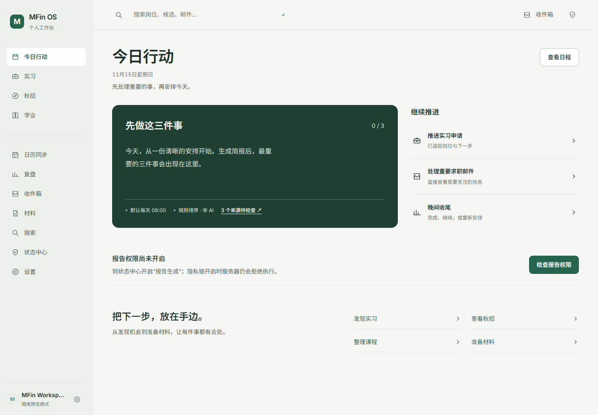
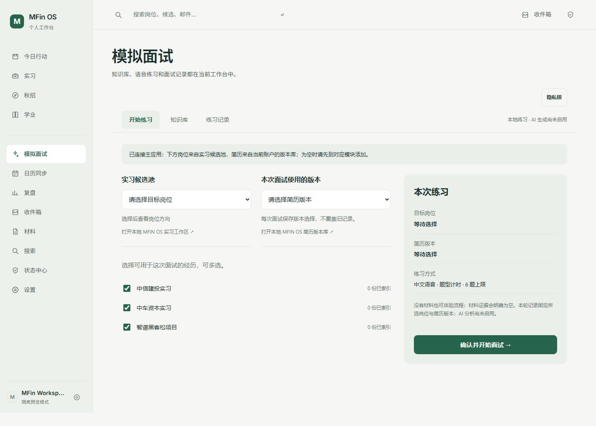
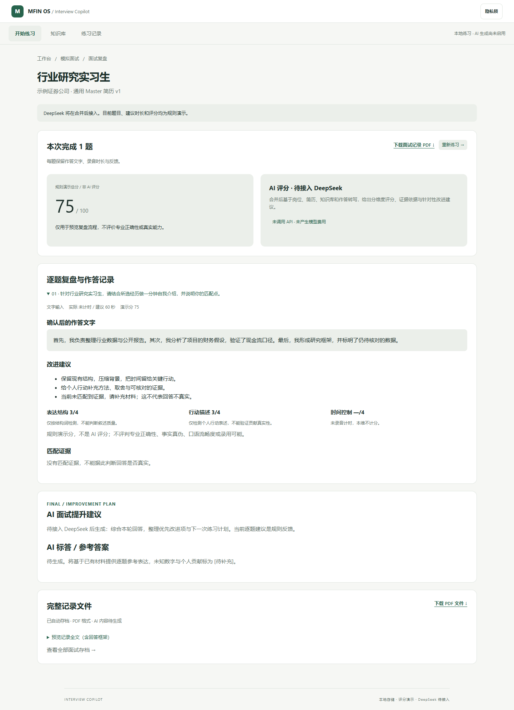
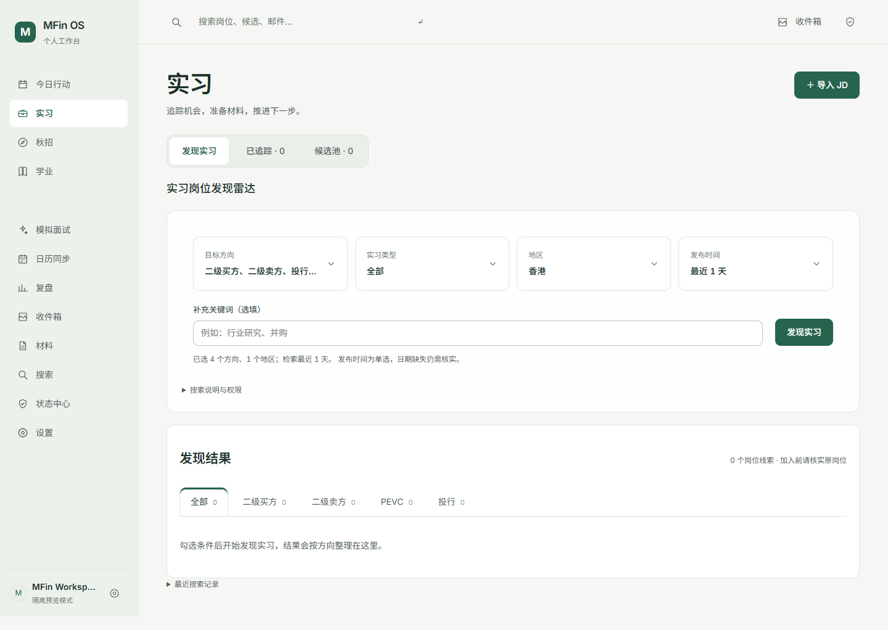

# PC 工作台与模拟面试改版

2026-11-15。用户授权整体 UI、Layout 和减少点击，并补充只处理 PC，以及一并优化刚接入的模拟面试。基于 main 的 PR #55 接入实现；本 PR 不发布部署。

## 改动

全站桌面使用低饱和深绿、清晰的标题层级、固定搜索栏和较安静的侧栏。首页以重点行动与下一步捷径组成双列布局。搜索支持 Ctrl/Cmd K；筛选选择后立即应用，分页与保存视图保留追踪页签。

模拟面试桌面入口直接显示岗位、简历和知识库选择；未完成练习可直接继续。练习、知识库、存档有常驻导航。嵌入模式移除重复品牌和准备标题；宽屏并排显示岗位与简历，摘要和提交操作保持可达。实际来源、录音同意、明确开始和结束、规则反馈标记保持。

| 操作 | 原路径 | 新路径 |
| --- | --- | --- |
| PC 主导航到面试准备 | 模拟面试 → 模拟面试卡片 → 开始准备 | 模拟面试直接显示准备表单 |
| 首页到追踪岗位 | 实习 → 已追踪 | 推进实习申请 |
| 更换筛选选项 | 选择 → 应用 | 选择即应用 |
| 全站检索 | 进入搜索 → 输入 → 提交 | 当前页输入 → 提交，或 Ctrl/Cmd K |

新增设计样式限定在桌面断点。原手机首页、页头和模拟面试入口保留；后续没有继续做手机设计或验收。

## 已验证

- 主仓库完整 CI：格式、治理、lint、类型、静态检查、根 140 项通过 / 11 项可选跳过、Web 211 项通过、Next.js 生产构建通过。
- PC 浅色/深色 24 项页面检查：HTTP 200，无文档横向溢出、无 pageerror。筛选即时应用、追踪上下文、搜索快捷键和提交路径已检查。
- 面试 6 项领域测试通过，包含合成 PDF/DOCX、索引、真实本地向量、来源定位、版本与删除链路；使用已有模型缓存，没有重新下载。
- 独立合成数据完成浏览器开始、文本作答、结束、复盘和存档流程；主应用 mock iframe 验证直接准备和知识库导航，无 pageerror。
- Impeccable 对改动的静态检查无发现。React 复核未新增数据请求瀑布或依赖；全站搜索和筛选复用原权限边界。

以上 UI 截图使用 mock/合成数据。没有读取或改动真实材料和练习记录，没有启用 DeepSeek、麦克风录制或外部发送；本次没有验证真实在线语音识别。

## 截图

## 雷达筛选微调

四个筛选模块默认展示条件摘要，PC 悬浮预览、点击固定展开；支持点击外部关闭、键盘展开和 Escape 返回触发按钮。移除全选控制，发布时间使用同名 radio 单选；已有多范围偏好按原最宽范围显示为一项，服务端继续兼容历史数据。

15 项浏览器交互检查通过，实际 FormData 仅含一个发布时间。ESLint、类型检查及 Web 211 项测试通过；Impeccable 扫描无发现。未触发真实搜索。

